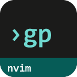
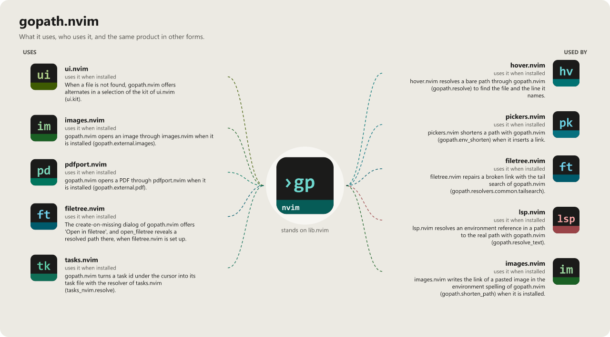

> **Beta stage — active development.** This repository is past its first shape and in
> active use, but the surface is not frozen: breaking changes are still possible. Pin a
> commit or tag if you depend on it.

# gopath.nvim

```
 ██████╗  ██████╗ ██████╗  █████╗ ████████╗██╗  ██╗
██╔════╝ ██╔═══██╗██╔══██╗██╔══██╗╚══██╔══╝██║  ██║
██║  ███╗██║   ██║██████╔╝███████║   ██║   ███████║
██║   ██║██║   ██║██╔═══╝ ██╔══██║   ██║   ██╔══██║
╚██████╔╝╚██████╔╝██║     ██║  ██║   ██║   ██║  ██║
 ╚═════╝  ╚═════╝ ╚═╝     ╚═╝  ╚═╝   ╚═╝   ╚═╝  ╚═╝
                                               .nvim
```

[](LICENSE)
[](https://neovim.io)
[](https://www.lua.org)


[](https://github.com/WKDSteve/gopath.nvim/actions/workflows/ci.yml)
[](https://wkdsteve.github.io/wkd/p/gopath/)

> Part of the [wkd](https://wkdsteve.github.io/wkd/) family — see this plugin's [page](https://wkdsteve.github.io/wkd/p/gopath/) on the site.

One key, and you are at the file the cursor is pointing at — however that
reference happens to be written. gopath.nvim resolves symbols, `require()`
paths and arbitrary file references under the cursor through a multi-phase
pipeline, so a `require("a.b")`, a bare path, a `:help` tag and a
stack-trace line all end in the same place: the right file, at the right line.

---

> **[buffer-ctx.nvim](https://github.com/WKDSteve/buffer-ctx.nvim)** — the
> other direction: it *writes* a `require("foo.bar")` or `path:line` reference,
> gopath jumps back to one.
>
> **[hover.nvim](https://github.com/WKDSteve/hover.nvim)** and
> **[images.nvim](https://github.com/WKDSteve/images.nvim)** — both call
> `resolve_at_cursor()` from outside, through `pcall`, so gopath stays a soft
> dependency on their side. What they rely on is
> [docs/FEATURES/INTEGRATIONS.md](docs/FEATURES/INTEGRATIONS.md).
>
> **[open.nvim](https://github.com/WKDSteve/open.nvim)** — takes over where
> the target is not a file at all: a URL, a directory, an application.
>
> **[tasks.nvim](https://github.com/WKDSteve/tasks.nvim)** — a task id
> (`lib.nvim/my-task`) in a to-do list, a commit message or a comment opens its
> task file, open or finished; with gF and `:Gopath open`, several matches are
> offered to pick from, told apart by kind, finishing day or path (also by the
> context menu's Open and Reveal). A group symbol (`[[group/perf]]`, cursor on the
> name) opens the file that explains the group. Only an id a vault
> knows counts, so a relative path is never taken for one
> (`tasks = { enable, vaults }` or `tasks = false`, see
> [All options](docs/configuration.md)).
>
> **Commits** — a commit hash (`a02ddae`, or `repo@a02ddae` as in the
> `commits:` lists of a task vault) under the cursor opens that commit: the
> `git show` in a float, split, vsplit, tab or the current window, or its page
> on the remote's web host. `gP` follows `commit.open` (default float),
> `<leader>pc` asks where, and a commit the repository lacks offers to fetch
> it. In the `git show` view a `diff --git` / `+++ b/` line jumps to the file
> (`commit = { enable, open }` or `commit = false`, see
> [Commits](docs/FEATURES/COMMITS.md)). Needs lib.nvim's `git.commit_ref`.
>
> All of the above are soft: without them everything else works unchanged.
> [lib.nvim](https://github.com/WKDSteve/lib.nvim) is the one real
> dependency — see [Requirements](docs/installation.md#requirements).

---

## Documentation

Start at [docs/README.md](docs/README.md) — what's where, and which question
each page answers.

### The Basics

- [Requirements](docs/installation.md#requirements) — Neovim version, required plugins and CLI tools.
- [Installation](docs/installation.md) — plugin managers and load-trigger variants.
- [Quickstart](docs/quickstart.md) — the first thing to run after installing.

### Configuration

- [What you get with the defaults](docs/what-you-get.md) — the keymap table that matters on day one.
- [All options](docs/configuration.md) — every `setup()` option and its default.
- [Commands / bindings cheatsheet](docs/BINDINGS.md) — the whole `:Gopath` subcommand tree.

### The Rest

- [What it does and what not](docs/scope.md) — the resolution phases, at a glance.
- [Why it does it that way](docs/Developer-Notes/DEV-README.md) — architecture, providers, resolvers.
- [Health check](docs/troubleshooting.md#health-check) — what `:checkhealth gopath` reports.
- [Troubleshooting](docs/troubleshooting.md#troubleshooting) — common failures and fixes.
- [Contributing](docs/CONTRIBUTING.md) — ground rules, project layout, and how to add a resolver.
- [Feedback](https://github.com/WKDSteve/gopath.nvim/issues)

`:help gopath` is the same reference inside the editor.

---

## License

[](LICENSE)

gopath.nvim is released under the [MIT License](https://opensource.org/licenses/MIT).

<!-- connections:begin (written by the app-icons tool of the workshop; change integrations.json there, not this block) -->
## Connections



**Uses**

- [filetree.nvim](https://github.com/WKDSteve/filetree.nvim): The create-on-missing dialog of gopath.nvim offers 'Open in filetree', and `open_filetree` reveals a resolved path there, when filetree.nvim is set up. ([picture](assets/graphs/pair/gopath.nvim--filetree.nvim.png))
- [images.nvim](https://github.com/WKDSteve/images.nvim): gopath.nvim opens an image through images.nvim when it is installed (`gopath.external.images`). ([picture](assets/graphs/pair/gopath.nvim--images.nvim.png))
- [pdfport.nvim](https://github.com/WKDSteve/pdfport.nvim): gopath.nvim opens a PDF through pdfport.nvim when it is installed (`gopath.external.pdf`). ([picture](assets/graphs/pair/gopath.nvim--pdfport.nvim.png))
- [tasks.nvim](https://github.com/WKDSteve/tasks.nvim): gopath.nvim turns a task id under the cursor into its task file with the resolver of tasks.nvim (`tasks_nvim.resolve`). ([picture](assets/graphs/pair/gopath.nvim--tasks.nvim.png))
- [ui.nvim](https://github.com/WKDSteve/ui.nvim): When a file is not found, gopath.nvim offers alternates in a selection of the kit of ui.nvim (`ui.kit`). ([picture](assets/graphs/pair/gopath.nvim--ui.nvim.png))
- [lib.nvim](https://github.com/WKDSteve/lib.nvim): the shared base of the plugins.

**Used by**

- [filetree.nvim](https://github.com/WKDSteve/filetree.nvim): filetree.nvim repairs a broken link with the tail search of gopath.nvim (`gopath.resolvers.common.tailsearch`). ([picture](assets/graphs/pair/filetree.nvim--gopath.nvim.png))
- [hover.nvim](https://github.com/WKDSteve/hover.nvim): hover.nvim resolves a bare path through gopath.nvim (`gopath.resolve`) to find the file and the line it names. ([picture](assets/graphs/pair/hover.nvim--gopath.nvim.png))
- [images.nvim](https://github.com/WKDSteve/images.nvim): images.nvim writes the link of a pasted image in the environment spelling of gopath.nvim (`gopath.shorten_path`) when it is installed. ([picture](assets/graphs/pair/images.nvim--gopath.nvim.png))
- [lsp.nvim](https://github.com/WKDSteve/lsp.nvim): lsp.nvim resolves an environment reference in a path to the real path with gopath.nvim (`gopath.resolve_text`). ([picture](assets/graphs/pair/lsp.nvim--gopath.nvim.png))
- [pickers.nvim](https://github.com/WKDSteve/pickers.nvim): pickers.nvim shortens a path with gopath.nvim (`gopath.env_shorten`) when it inserts a link. ([picture](assets/graphs/pair/pickers.nvim--gopath.nvim.png))
<!-- connections:end -->
